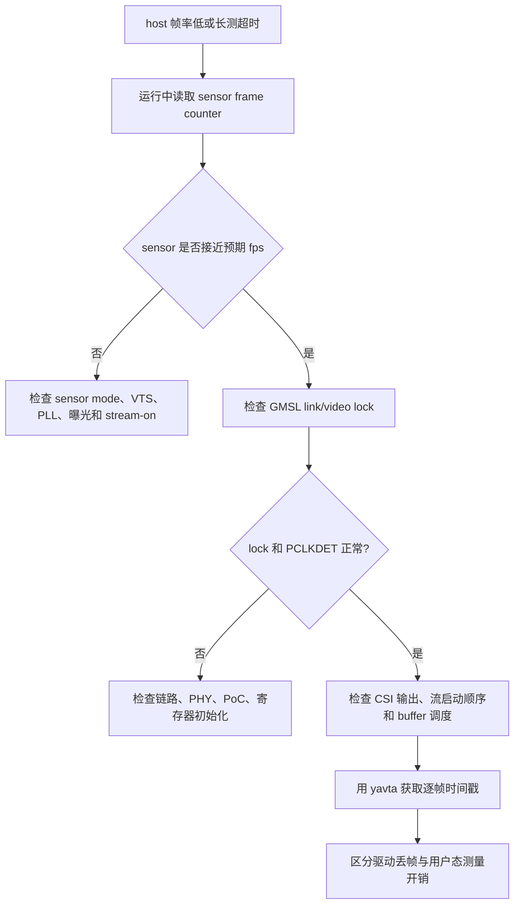

# OX03H10 + MAX96717 + MAX96716A 出图不稳定问题案例总结

本文总结 BeagleY-AI 上 OX03H10 相机的“能出图但持续采集不稳定”问题，包括
定位过程、根因、代码修复、调试命令和验收标准。

关联记录：

- [完整测试日志](./adi-gmsl-test.md)
- [执行计划与 A-E 实验结果](./ox03h10-stability-plan.md)
- [原始参考配置时序](../scripts/ox03h10-camera-configure.sh)

## 1. 系统拓扑

```text
OX03H10 sensor (0x36)
        |
        | 4-lane MIPI CSI-2, RAW12
        v
MAX96717 serializer (0x40)
        |
        | GMSL2 forward video + reverse control
        v
MAX96716A deserializer (0x28)
        |
        | 4-lane MIPI CSI-2 D-PHY
        v
J722S CSIRX / /dev/video3
```

Linux 中三颗器件分别注册为 V4L2 subdev。用户空间打开 `/dev/video3` 时，
媒体框架会沿链路逐级调用 `enable_streams`。

## 2. 问题现象

典型现象不是完全无图，而是：

- 短采集 10 帧通常能成功，图像内容也正常。
- 300 帧长测有时成功，有时只收到几十帧后帧率降到 1–3 fps。
- `dmesg` 中通常看不到 `CRC error`。
- GMSL link lock 和 video lock 在异常时仍可能保持为 1。
- 同一个采集命令重复执行，结果不一致。

这类现象容易让人误判为 sensor、摄像头连接或 GMSL 电缆故障。真正有效的方法
是把问题分成：

1. sensor 是否仍在出帧。
2. 数据是否从 sensor 进入 serializer。
3. deserializer 是否仍输出 CSI 数据。
4. SoC 是否及时把完整帧交给用户空间。

## 3. 先定位“谁少出了帧”

### 3.1 读取 OX03H10 frame counter

OX03H10 提供 32-bit frame counter：

- `0x483e`：frame counter high byte
- `0x483f`：frame counter low byte

板上 sensor I2C 地址为 `0x36`，经由 serializer/deserializer 转发。调试时使用：

```sh
i2ctransfer -f -y 6 w2@0x36 0x48 0x3e r1
i2ctransfer -f -y 6 w2@0x36 0x48 0x3f r1
```

在采集运行时间隔读取，并计算帧数差和经过时间。

本项目得到的基线结果：

- host 侧执行 600 帧采集，最终完成 600/600。
- sensor frame counter 在采样区间内以约 60.8–62 fps 增长。
- 这说明 camera sensor 没有停止出帧，问题在接收端的数据交付或启停状态。

### 3.2 同时检查链路状态

MAX96716A 关键状态：

| 寄存器 | 检查内容 | 正常现象 |
|---|---|---|
| `0x0013[3]` | GMSL Link A locked | 运行期间为 1 |
| `0x01fc[0]` | Pipe Y video lock | 当前 pipe 使用时为 1 |
| `0x021c[0]` | Pipe Z video lock | 当前 pipe 使用时为 1 |
| `0x5013` | video memory overflow / loss lock | 为 0 |
| `0x55c-0x55f` | pixel CRC 错误计数 | 为 0 |
| `0x0112[7]`（SER） | PCLKDET | sensor 输入时通常为 1 |

示例：

```sh
i2ctransfer -f -y 4 w2@0x28 0x00 0x13 r1
i2ctransfer -f -y 4 w2@0x28 0x01 0xfc r1
i2ctransfer -f -y 4 w2@0x28 0x02 0x1c r1
i2ctransfer -f -y 4 w2@0x28 0x50 0x13 r1
i2ctransfer -f -y 4 w2@0x28 0x55 0x5c r1
```

本项目异常和正常期间这些状态大多都保持正常，因此不能只根据 dmesg 或单独一个
lock bit 判断根因。

## 4. 诊断路径



调试时每次只改变一个变量，并记录：

- 实际收到的帧数。
- sensor frame counter 首尾值。
- link/video lock。
- overflow、FIFO warning 和错误计数。
- 使用完全相同的采集工具和 buffer 数量。

## 5. 排除的错误方向

### 5.1 不是简单的 CRC 或物理链路故障

虽然没有打印 `CRC error`，这仍不足以证明链路完全无误；反过来，也不能只因为
日志没有 CRC 就继续修改 sensor。最终检查了 pixel CRC 计数、overflow 和 lock，
这些状态在正常运行期间正常。

### 5.2 CSI 速率并不是越高越好

OX03H10 手册列出了 1920x1536/60 fps 的带宽范围，MAX96716A `0x0320` 也支持
100–2500 Mbps/lane 的预定义频率。

曾试验：

- `0x0320=0x2f`：1500 Mbps/lane。
- `0x0320=0x2e`：1400 Mbps/lane。
- 修改 DPLL 前先复位 `0x1d00[0]`。

结果：

- sensor counter 仍在约 60 fps。
- GMSL link 和 video lock 仍显示正常。
- host 收到 0 帧。

恢复 400 MHz overlay 和 `0x0320=0x2c` 后恢复。说明当前 sensor 配置、PLL、
`0x4837` MIPI timing 和板端 CSI RX 已经形成一套匹配组合，不能只改 DES 频率。

学习要点：

- 文档中的带宽范围是器件能力，不一定就是当前 sensor mode 的实际输出。
- 修改 CSI PHY/DPLL 时必须同步核对 sensor PLL、MIPI PCLK period 和接收端
  D-PHY link frequency。
- 设备树中的 `link-frequencies` 必须和实际 D-PHY 配置一致。

### 5.2.1 当前驱动中的 CSI 速率是硬编码的

MAX96716A 的 CSI TX DPLL 配置目前写死在固定初始化表中：

- [beagley_max96716a_regs.h](../sources/linux-beagley-legacy-tpg/drivers/media/i2c/beagley_max96716a_regs.h:14)
  固定写入 `0x0320=0x2c`。
- [max96716a.c](../sources/linux-beagley-legacy-tpg/drivers/media/i2c/max96716a.c:534)
  只把设备树中的 `link-frequency` 保存到 `priv->link_frequency`。
- `priv->link_frequency` 当前仅用于 V4L2 control 和日志，没有参与
  `0x0320`、DPLL reset 或其他 CSI PHY 寄存器的计算。

因此，修改设备树中的 `link-frequency` 不会自动改变 MAX96716A 的 CSI PHY
速率。运行时直接使用 I2C 写入寄存器会生效，但以下操作会覆盖人工修改：

- 驱动 unbind/rebind；
- 模块重新加载；
- 板子重启；
- 下一次执行固定初始化表。

本项目做过直接 I2C 写入验证：

```sh
# 先复位 PHY1 DPLL
i2ctransfer -f -y 4 w3@0x28 0x1d 0x00 0xf4

# 写 1500 Mbps/lane
i2ctransfer -f -y 4 w3@0x28 0x03 0x20 0x2f

# DPLL 退出复位
i2ctransfer -f -y 4 w3@0x28 0x1d 0x00 0xf5

# 读回确认
i2ctransfer -f -y 4 w2@0x28 0x03 0x20 r1
```

读回值为 `0x2f`，证明人工写入确实生效。后来无法出图并不是写入被忽略，而是
1500 Mbps/lane 的 DES 输出与当前 sensor mode、接收端 D-PHY 或设备树配置
不匹配。

### 5.2.2 12-bit PWL 和 24-bit uncompressed 的带宽要求不同

不能只看到“1920x1536@60 的最低速率约为 1400 Mbps/lane”就提高所有配置。
OX03H10 手册 Table 3-3 区分了输出位深：

- HDR4/HDR3 uncompressed 24-bit：最低约 **1400 Mbps/lane**。
- HDR4/HDR3 PWL 20/16/14/12-bit：最低值随位深下降。
- 当前配置启用了 PWL，输出为 12-bit。

证据：

- [beagley_ox03h10_regs.h](../sources/linux-beagley-legacy-tpg/drivers/media/i2c/beagley_ox03h10_regs.h:104)
  写入 `0x431F=0x20`。
- `0x431F[5]=1` 表示 PWL 0 enable。
- `0x431F[4:3]=0` 表示 12-bit PWL。
- [OX03H10 数据手册](/home/fyx/ox03h10_capture/raw/sensor_x3h/OX03H10_a_CSP_DS_1_21_1.md:1173)
  Table 3-3 列出了不同输出格式的 MIPI 最低速率。

当前 12-bit PWL 模式对带宽的需求低于未压缩 24-bit 模式。
MAX96716A `0x0320=0x2c` 对应约 1200 Mbps/lane，已经高于当前模式的
最低需求，并保留了一定余量。

1500 Mbps/lane 实验失败说明：单纯提高 DES PLL 频率不会自动提高有效吞吐，
反而可能让 DES 输出时钟超出接收端当前配置范围。正确的 CSI 速率必须由
sensor 的真实输出格式推导，不能只使用 datasheet 中最高格式的建议值。

### 5.2.3 后续应改为统一速率配置

当前固定表可以作为已知稳定基线，但长期应把配置改成可推导、可校验的模式：

1. 明确 sensor 输出格式：12/14/16/20-bit PWL 或 24-bit uncompressed。
2. 结合分辨率、帧率、sensor PLL 和 blanking 计算实际 Mbps/lane。
3. 根据 V4L2 `link_frequency` 映射 MAX96716A 的
   `phy1_csi_tx_dpll_predef_freq`。
4. 修改频率前先复位对应 DPLL，例如 PHY1 的 `0x1d00[0]`。
5. 同步验证 sensor `0x4837` MIPI PCLK period、J722S D-PHY 和设备树
   `link-frequencies`。
6. 每种模式都执行 300 帧、600 帧和连续启停测试。

如果后续切换到未压缩 24-bit、提高帧率或改变输出位深，应重新计算速率，
可能需要使用 1400 Mbps/lane 或更高档位。但在当前 12-bit PWL 模式下，
不需要为了“手册建议更高”而盲目把 `0x0320` 从 `0x2c` 调高。

### 5.3 不是 `v4l2-ctl` 显示的唯一数据

`v4l2-ctl --stream-to=...` 会复制每帧 5,898,240 字节到用户空间。高 RAW12
帧率下，复制和大 buffer 分配会显著影响结果：

- 复制路径可能只显示约 8–18 fps。
- `--stream-mmap=32` 请求约 188 MB DMA 内存，超过板端 144 MiB CMA，
  会产生 `__cma_alloc` 失败。
- `v4l2-ctl` 的短测统计包含其自身启动和 frame-skip 处理，可能显示约 52–56 fps，
  即使 yavta 时间戳证明实际为 60 fps。

调试吞吐时优先使用：

```sh
yavta -c300 -n4 /dev/video3
```

在已经配置好 `BG12 1920x1536` 的情况下，yavta 会使用当前格式。最终输出示例：

```text
Captured 300 frames in 4.938725 seconds (60.744420 fps)
```

不要超过 8 个 5.9 MB buffer；正常测试使用 4 个即可。

## 6. 根因

根因是 **V4L2 子设备启流顺序错误**。

原顺序：

1. MAX96716A 启动 CSI 输出：`0x0313=0x02`
2. MAX96717 启动自己的视频输出：`0x0002=0x43`
3. 最后才调用 OX03H10 `0x0100=1`

参考实现要求：

1. DES 输出开启：`0x0313=0x02`
2. sensor 开始出帧：`0x0100=1`
3. SER 视频输出开启：`0x0002=0x43`
4. 轮询 video lock

当 serializer 先打开视频通道时，sensor 尚未提供稳定视频包。某些运行可以恢复，
另一些运行会进入持续丢帧或低交付状态，而 sensor 自身仍正常输出。这解释了：

- 为什么 sensor counter 正常。
- 为什么 GMSL 和 video lock 看起来正常。
- 为什么短测经常成功、长测偶发失败。
- 为什么同样的软件会在不同启动中表现不同。

## 7. 代码修复

### 7.1 serializer 启流顺序

修改文件：

- [max96717.c](../sources/linux-beagley-legacy-tpg/drivers/media/i2c/max96717.c:498)

核心逻辑：

```c
if (!priv->pattern) {
	/* 先启动上游 sensor */
	ret = v4l2_subdev_enable_streams(priv->source_sd,
					 priv->source_sd_pad,
					 sink_streams);
}

/* sensor 出流后再启动 SER CSI 输出 */
ret = max96717_start_csi(priv, true);
```

失败时反向回滚：

```text
sensor enable 失败
    -> 返回错误

SER CSI enable 失败
    -> 关闭 SER CSI
    -> 停止 sensor
    -> 返回错误
```

停流顺序改成：

```text
停止 sensor
    -> 停止 SER CSI
    -> 更新 enabled_source_streams
```

只有在 sensor 停止成功后，才把流状态标记为已停止。这样失败时状态不会与硬件
不一致。

### 7.2 增加 link/video lock 检查

修改文件：

- [max96716a.c](../sources/linux-beagley-legacy-tpg/drivers/media/i2c/max96716a.c:80)

probe 阶段：

- 每 50 ms 读取 `0x0013`，最多等待约 1 秒。
- 检查 `MAX96716A_LINK_LOCKED`，即 bit3。

stream-on 后：

- 每 100 ms 检查 pipe Y/Z 的 `0x01fc[0]`、`0x021c[0]`。
- 任一活动 pipe lock 即认为输出正常。
- 超时后停止上游流并关闭 DES `0x0313` 输出。

这样驱动不再把“命令写成功但没有任何帧输出”误判为 stream-on 成功。

### 7.3 最终启流顺序

最终链路顺序：

```text
MAX96716A 0x0313=0x02
    |
    v
MAX96717 enable
    |
    v
OX03H10 0x0100=1
    |
    v
MAX96717 0x0002=0x43
    |
    v
轮询 MAX96716A video lock
```

停流顺序：

```text
OX03H10 0x0100=0
    |
    v
MAX96717 0x0002=0x03
    |
    v
MAX96716A 0x0313=0x00
```

## 8. 调试/验收命令

### 8.1 恢复真实 sensor 路由

```sh
sh scripts/ox03h10-camera-configure.sh
```

包括：

- tunnel 模式 `0x0474=0x09`
- RAW12 remap
- `SBGGR12_1X12/1920x1536`
- `/dev/video3` 设置 `BG12`

### 8.2 sensor counter 和链路状态

```sh
sh backups/legacy717-tpg/stage-a-diagnose.sh
```

观察：

- sensor frame counter 每秒增长是否接近 60。
- pipe Y/Z lock 是否至少一个为 1。
- `0x5013` 是否保持 0。

### 8.3 三次 300 帧验收

```sh
for n in 1 2 3; do
    timeout 15 yavta -c300 -n4 /dev/video3
done
```

本项目最终结果：

| 项目 | 结果 |
|---|---:|
| yavta run 1 | 60.056 fps |
| yavta run 2 | 59.992 fps |
| yavta run 3 | 60.028 fps |
| 600 帧长测 | 600/600，60.02 fps |
| 20 次连续启停 | 20/20 成功，共 6000 帧 |

### 8.4 保存真实图像

```sh
timeout 20 v4l2-ctl -d /dev/video3 --stream-mmap=4 \
    --stream-count=10 --stream-to=/tmp/camera.raw
```

这是用户态拷贝路径，不要用它的 fps 判断硬件吞吐，只用于检查图像。

当前最终预览位于：

- `backups/adi-camera-test/final-lock-fix-frame10.png`

## 9. 判断标准

一次修复完成至少应满足：

- sensor frame counter 与 host 接收帧数基本一致。
- GMSL link lock 和活动 pipe video lock 正常。
- 无 memory overflow、FIFO warning 或持续增长的 pixel CRC 计数。
- 300 帧和 600 帧采集都能完成。
- 使用 yavta 时间戳确认约 60 fps。
- 连续启停不依赖手工 I2C 寄存器修补。
- 保存的后段图像内容正常。

本项目最终通过：

- 600 帧稳定采集。
- 三次 300 帧均约 60 fps。
- 20 次连续启停全部成功。
- `checkpatch.pl` 为 0 errors、0 warnings。

## 10. 可复用经验

1. 先证明 sensor 是否仍在出帧，再检查下游。
2. `CRC error` 日志不是完整的链路健康指标。
3. GMSL lock 和 video lock 正常，不代表 V4L2 帧交付正常。
4. 多级 V4L2 subdev 链路要严格检查 `enable_streams` 和 `disable_streams` 顺序。
5. 每次只改一个变量，并记录寄存器、帧计数和重现次数。
6. 高带宽 RAW 图像优先使用 yavta 时间戳或无拷贝 mmap 测试。
7. 不要盲目提高 CSI PHY 速率；sensor PLL、MIPI timing、DES DPLL 和接收端
   D-PHY 必须是一套匹配配置。
8. 连续启停和长测比一次短采集更能暴露状态机和初始化顺序问题。

## 11. DCC 文件格式与 ISP 2A 的经验

RAW 出图稳定后接入 TI ISP 时，DCC 文件的“能读”和“能被 TI parser 正确解析”
是两件事。本项目的两个 OX03H10 DCC 文件在正常 DCC 容器末尾额外附加了
4 字节标准 CRC-32：

```text
dcc_2a_wdr_304.bin:  37,876 字节有效 DCC + f6 f9 e6 c7
dcc_viss_wdr_304.bin: 73,799 字节有效 DCC + 59 04 dd 79
```

CRC 本身可以精确复算，但这不是 TI DCC 格式的一部分。TI parser 查找某个不存在
的 component 时会依赖 `buffer_end` 判断结束；多出的 trailer 使指针无法恰好
停在末尾，于是 CRC 被当成下一段 header。实际表现不是“CRC mismatch”，而是：

```text
Invalid Desc Id 2
AWB_TI_process returned error 0xffffffff
```

测试时只去掉末尾 4 字节，其他字节完全不动，VA 2A 错误立即消失，300 帧完成。
因此遇到 TI 2A 的 AWB 错误时，应先打印或解析 DCC component 表，检查：

- 文件大小是否严格等于各 `total_file_sz` 之和。
- 是否存在尾部私有 header/CRC/trailer。
- 请求的 descriptor 是否真的存在于当前 2A/VISS 文件。

DCC 304 的 RGB2RGB component 还有 20 个 region。历史修改把通用的
`DCC_MAX_PHOTO_SPACE_INST` 从 10 扩到 20，但没有同步把
`DCC_RGB2RGB1_MAX_PHOTO_SPACE_INST` 从 10 扩到 20。解析器虽然能读取 20 个
region，却只分配 10 组 RGB2RGB 参数，造成结构体内越界。经验是：

1. 每个模块的 region 数组容量必须单独核对，不能只改通用检查宏。
2. 结构体扩容后，所有 producer/consumer 必须使用同一套宏重新编译。
3. 不要只看源码或 patch 文件，要检查板上实际 firmware 的反汇编和 hash。
4. 短测正常不能证明所有 photospace region 正常，应分别覆盖高增益和低色温区间。
