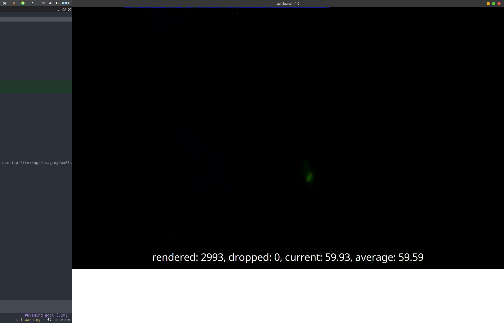

# OX03H10 ISP 与网络推流实现

本文记录 OX03H10 从 Linux V4L2 RAW12 输入，经 TI VPAC VISS1 ISP 和
wave5 硬件 H.264 编码，通过 RTP/UDP 推送到 PC GStreamer 显示的完整实现。

## 1. 最终目标链路

```text
OX03H10 sensor
    -> MAX96717 serializer
    -> MAX96716A deserializer
    -> J722S CSIRX / /dev/video3
    -> tiovxisp / VPAC_VISS1
    -> NV12 1920x1536
    -> v4l2h264enc / /dev/video1
    -> RTP/UDP
    -> PC GStreamer
    -> avdec_h264
    -> autovideosink
```

调试时保留两条独立验收路径：

1. 板端 `tiovxisp ! fakesink`，用于隔离 ISP、DCC 和 2A。
2. PC RTP 显示，用于验证编码、网络、解码和显示。

## 2. 当前板端和 PC

板端：

- SSH：`root@10.42.0.247`
- 网络：`eth0 = 10.42.0.247/24`
- sensor 输出：`SBGGR12_1X12 1920x1536@60`
- 视频节点：`/dev/video3`
- 编码节点：`/dev/video1`，驱动 `wave5-enc`

PC：

- 有线网卡：`enp2s0 = 10.42.0.1/24`
- GStreamer 1.24
- 已安装 RTP、H.264 解码、videoconvert、autovideosink、JPEG 和 PNG 编码组件

## 3. DCC 规范化

原始 DCC 文件末尾有 4 字节文件级 CRC-32，TI DCC parser 不理解这个 trailer。
镜像安装时执行以下处理：

```text
dcc_*.bin.orig   原始文件
dcc_*.bin.crc32  原文件 CRC，文本形式
dcc_*.bin        去掉末尾 4 字节、供 tiovxisp 使用
```

实现位置：

- `sources/meta-beagley-edgeai/recipes-tisdk/ti-psdk-rtos/files/normalize-ox03h10-dcc.py`
- `sources/meta-beagley-edgeai/recipes-tisdk/ti-psdk-rtos/ti-vision-apps.bbappend`

安装时校验：

```text
stored_crc == zlib.crc32(data_without_trailer)
```

目标安装目录：

```text
/opt/imaging/ox03h10/wdr/
```

任何 CRC 不匹配都会使 recipe 构建失败，避免把损坏文件带入镜像。

## 4. DCC 20-region 修复

DCC 304 的 RGB2RGB desc 10 有 20 个 photospace region。原补丁只把通用
`DCC_MAX_PHOTO_SPACE_INST` 改为 20，RGB2RGB 参数数组仍为 10。

修复后：

```c
#define DCC_MAX_PHOTO_SPACE_INST          (20U)
#define DCC_RGB2RGB1_MAX_PHOTO_SPACE_INST (20U)
```

RGB2RGB parser 在写入前还会检查：

```c
if (dcc_ptrs->num_regions > DCC_RGB2RGB1_MAX_PHOTO_SPACE_INST)
    return -1;
```

修改位置：

- `sources/meta-beagley-edgeai/recipes-tisdk/ti-psdk-rtos/files/0004-dcc-support-20-photospace-regions.patch`

该 patch 同时应用到：

- RTOS firmware，即板端 MCU2 实际 DCC parser。
- Linux `ti-vision-apps` 用户态。

## 5. 固定 2A 基线

当前 sensor driver 没有完整的 exposure/gain V4L2 controls，因此固定曝光/增益是
首先用于验证 ISP 和推流链路的基线。

原 `tiovxisp` 即使在 AE/AWB disabled 时，也会先调用
`TI_2A_wrapper_process()`，然后才检查 mode。增加：

- `0006-skip-ti-2a-when-disabled.patch`

当所有 sink pad 都设置：

```text
ae-mode=2
awb-mode=2
```

时，postprocess 直接返回，不执行 H3A mapping、TI 2A 或 V4L2 control 写入。
这样固定参数模式不会承担 2A 的处理开销，也不会因无效 DCC 2A 数据提前失败。

自动 AE/AWB 仍需要后续补齐 OX03H10 sensor controls 和 sensor-specific mapping。

### 5.1 RAW12 dmabuf 零拷贝导入

性能分析发现 `tiovxisp0:src` 线程 98% CPU 消耗在
`gst_tiovx_validate_tiovx_buffer()` 调用的 `memcpy_neon`。RAW12 单帧为
5,898,240 字节，默认路径每帧都把它复制进 TIOVX buffer pool，因此只能达到
约 14 fps。

增加：

- `0007-zero-copy-dmabuf-import.patch`

该补丁对 V4L2 dmabuf：

1. 用 `tivxMemTranslateFd()` 注册并取得虚拟/物理地址。
2. 按 dmabuf fd 缓存 imported raw-image object array。
3. 创建轻量 GstBuffer 包装器，只引用原 dmabuf memory。
4. 在新包装器上挂 TIOVX raw-image meta，不再执行 CPU memcpy。
5. 非 dmabuf、不能翻译或不能导入时仍回退原 copy 路径。

缓存是必要的：V4L2 pool 会复用有限数量的 buffer，不能每帧创建新的 TIOVX
object array，否则会耗尽 `TIVX_RAW_IMAGE_MAX_OBJECTS`。

当前零拷贝路径在进程退出时会看到少量
`vxReleaseContext ... object_array` warning，这是缓存引用由 TIOVX context
统一回收，不是运行期错误，也没有持续增长。正常运行时无 AWB、DCC、segfault
或 descriptor exhaustion。

## 6. 构建与部署

进入构建环境：

```sh
cd /home/fyx/work/ti/am67a/yocto/yocto-build
source sources/oe-core/oe-init-build-env build
```

构建三个目标：

```sh
bitbake ti-vision-apps ti-edgeai-firmware-beagley edgeai-gst-plugins
```

必须使用主构建目录 `build`，不要使用 `build-adi`：

| 构建目录 | 内核源码 | 驱动路径 | 内核版本 |
|---|---|---|---|
| `build` | `sources/linux-beagley` | 老架构 root `max96717.c` | `6.12.57-ti` |
| `build-adi` | `sources/linux-beagley-adi-test` | Maxim GMSL framework | `6.12.57-adi-ti` |

稳定 60 fps 的历史结果是 `build` 老架构。`build-adi` 是隔离实验，生成的模块
与当前板端运行内核 vermagic 不兼容，不能直接部署。

计划部署文件：

```text
/usr/lib/firmware/beagley_edgeai/vx_app_rtos_linux_mcu2_0.out
/usr/lib/gstreamer-1.0/libgsttiovx.so
/usr/lib/libgsttiovx-1.0.so.1.0
/usr/bin/ox03h10-stream
/usr/share/ox03h10/ox03h10-receive
/opt/imaging/ox03h10/wdr/dcc_*.bin
/opt/imaging/ox03h10/wdr/dcc_*.bin.orig
/opt/imaging/ox03h10/wdr/dcc_*.bin.crc32
```

部署前备份板上现有文件；部署 firmware 后重启板端，确保 remoteproc 实际加载新
MCU2 镜像。

## 7. 一键脚本

板端：

```sh
ox03h10-stream -p 10.42.0.1
```

默认参数：

```text
1920x1536@60
H.264 12 Mbit/s
RTP/UDP port 5000
AE/AWB disabled
关键帧间隔 60
```

指定帧数和自动模式：

```sh
ox03h10-stream -p 10.42.0.1 -f 300
ox03h10-stream -p 10.42.0.1 -m auto
```

PC 实时显示：

```sh
ox03h10-receive
```

只统计、不显示：

```sh
ox03h10-receive -m stats
```

传输并保存一个 JPEG：

```sh
ox03h10-receive -m snapshot -o /tmp/ox03h10.jpg
```

PC 脚本默认等待 100 ms jitter buffer，RTP payload type 为 96。

## 8. 分阶段验收

### 8.1 DCC 文件

```sh
ls -l /opt/imaging/ox03h10/wdr/
cat /opt/imaging/ox03h10/wdr/dcc_2a_wdr_304.bin.crc32
```

要求：

- `.orig` 保留原始长度。
- 运行文件比 `.orig` 少 4 字节。
- `.crc32` 与安装日志一致。

### 8.2 ISP NV12

固定 2A 后运行：

```sh
ox03h10-stream -p 10.42.0.1 -f 300
```

日志不得包含：

```text
Invalid Desc Id
AWB_TI_process returned error
TI_2A_wrapper_process returned error
too many regions
```

当前实测：

| 路径 | 帧数 | 耗时 | 结论 |
|---|---:|---:|---|
| raw V4L2 | 300 | 5.59 s | raw 通路未回退 |
| VPAC_VISS1 -> NV12 | 300 | 6.00 s | 含初始化约 50 fps，稳态接近 60 fps |
| VPAC_VISS1 -> NV12 | 600 | 10.76 s | 含初始化约 56 fps |
| VISS + H.264 + RTP + PC decode | 300 | board 6.96 s | PC average 约 52.5 fps，dropped 0 |

10 分钟 PC 实时显示长测最终数据：

| 指标 | 结果 |
|---|---:|
| PC rendered | 36,870 帧 |
| PC dropped | 0 |
| PC current FPS | 60.05 |
| PC average FPS | 59.98 |
| 板端进程 CPU | 约 43% |
| 板端 available memory | 约 2.0 GiB |

零拷贝生效前，`tiovxisp0:src` 线程约 98% CPU 消耗在
`memcpy_neon`。启用 dmabuf 导入后，板端进程总 CPU 降到约 43%，不再出现
每帧复制 RAW12 导致的吞吐饱和。长测期间没有运行期 VISS、CSI、DMA 或编码器
错误。

### 8.3 图像内容

分别保存首帧、中间帧和尾帧。若实际场景过暗，使用 sensor 的
`test_pattern` control 输出梯度或棋盘图，验证格式、颜色和帧间变化，然后恢复
正常模式。当前老架构下切换 MAX96717 test pattern 会导致无帧输出，因此该调试
方式暂不能作为最终图像验收手段。

### 8.4 PC 显示

PC 执行：

```sh
ox03h10-receive -m display
```

实际 PC 显示截图：



截图中的窗口是 PC `autovideosink` 正在显示板端 NATIVE 1920x1536 H.264/RTP。
画面整体偏暗是当前镜头场景/固定 sensor 配置造成的，右上角画面内容持续变化，
底部 `fpsdisplaysink` 显示约 59.6 fps、dropped 0。

要求：

- 窗口持续刷新。
- 无冻结、全黑、全绿或固定彩条。
- `fpsdisplaysink` 的 average 不低于 30 fps，目标 50-60 fps。

### 8.5 稳定性

最终至少执行：

```text
ISP/编码 300 帧
ISP/编码 600 帧
连续推流启停 10 次
PC 实时显示 10 分钟
```

记录板端处理帧率、编码帧率、RTP 码率、PC 显示帧率和错误计数。

当前 10 分钟显示已取得 36,870 帧、平均 59.98 fps、dropped 0 的结果。连续
启停测试仍须在板端真正冷启动后复验：曾用短 timeout 强行结束长测，下一次
进程立即出现 `com.ti.hwa.vpac_viss` node create 失败和 `cmd_status=-7`，
随后十轮均无法启动。该现象说明 VISS/IPC 清理状态不能靠循环重试恢复。

正确的启停验收方式：

1. 先启动 PC receiver。
2. 板端使用有限帧数，例如 `ox03h10-stream -f 120`。
3. 等待 sender 正常处理 EOS 并退出，客户端必须取得 rendered 帧计数或有效
   JPEG，不能只检查 sender 返回码。
4. 确认没有残留 `gst-launch-1.0`、`tiovxisp` 或编码进程后，再开始下一轮。
5. 若出现 `NODE_CREATE`/`cmd_status=-7`，保存日志并重新冷启动，不能在同一
   失效状态上重复十次。

PC 端验收脚本：

```sh
/home/fyx/work/ti/am67a/yocto/yocto-build/sources/meta-beagley-edgeai/recipes-tisdk/ti-psdk-rtos/files/ox03h10-restart-test.sh \
    -p root@10.42.0.247 -c 10 -f 120 -o /tmp/ox03h10-restart-test
```

脚本会自动探测 PC IP，每轮先启动 snapshot receiver，再通过 SSH 启动有限帧
sender。它只有在 sender 正常退出、JPEG 为 1920x1536 且图像不是单一时才记为
PASS。遇到 sender 超时或 VISS node-create 失败会立即终止，避免继续污染运行
状态。结果和逐轮日志保存在 `-o` 指定目录，末行应为 `PASS=10/10`。

当前构建产物：

```text
/usr/share/ox03h10/ox03h10-restart-test
sha256sum = df41f0074e72d96865a2e9a7eb82e91fde955635cc161a255fd29809fb960175
```

10 分钟长测可以一次采集板端、网络和 PC 解码统计：

```sh
/home/fyx/work/ti/am67a/yocto/yocto-build/sources/meta-beagley-edgeai/recipes-tisdk/ti-psdk-rtos/files/ox03h10-endurance-test.sh \
    -p root@10.42.0.247 -d 600 -f 60 \
    -o /tmp/ox03h10-endurance
```

脚本使用 `num-buffers=36000` 让 sender 在处理完 10 分钟帧数后自然 EOS，而不是
超时强杀。`summary.txt` 会记录：

```text
board_network_mbps
pc_network_mbps
pc_rendered
pc_dropped
pc_current_fps
pc_average_fps
board_cpu_rss_sample
board_error_count
receiver_error_count
```

当前长测脚本构建产物：

```text
/usr/share/ox03h10/ox03h10-endurance-test
sha256sum = 856612a649701c05131b8ba8db9c209992f99eb596abc0ae308b7aac3016732e
```

## 9. 故障排查

### `Invalid Desc Id`

确认 `tiovxisp` 使用的是去掉 trailer 的 `dcc_*.bin`，不是 `.orig`。

### `too many regions`

确认 MCU2 和用户态均已重新构建并部署 20-region patch。

### `Unable to negotiate`

检查 H.264 encoder 是否接受 NV12、分辨率是否在 V4L2 驱动限制内，以及 PC
RTP caps 是否与 sender 的 `pt=96` 一致。

### PC 无图但板端正常

检查：

- 双向网络可达。
- PC 防火墙是否允许 UDP 5000。
- receiver 是否在 sender 开始前启动。
- `config-interval` 是否使 receiver 能取得 SPS/PPS。

### 低帧率

先用 AE/AWB disabled 隔离 2A；再分别测量：

```text
v4l2src ! tiovxisp ! fakesink
v4l2src ! tiovxisp ! v4l2h264enc ! fakesink
```

据此判断瓶颈在 ISP/2A、编码器还是网络。

### `Unable to init TIOVX module` / `cmd_status=-7`

检查是否有上一次 `gst-launch` 进程未退出。若长测被强行终止后，新进程在任何
帧输出前即报：

```text
Target kernel, TIVX_CMD_NODE_CREATE failed
kernel init for node 0, kernel com.ti.hwa.vpac_viss ... failed
```

说明板端 VISS/IPC 状态已失效。保存日志后重启板端；若连续失败，需要断电重上
电。不要在失效状态上继续循环启动。

### 软重启后 `/dev/video3` 不存在

检查：

```sh
dmesg | grep -E "max96717|max96716|ox03h10"
```

若 MAX96717 报 `-EREMOTEIO`，说明摄像头侧电源状态没有随 SoC 软重启复位。
重新绑定 I2C 驱动可能恢复枚举，但不能可靠恢复完整 CSI 状态；推荐做一次真正
的断电重上电。不要依赖运行时 unbind/rebind CSI media 驱动，当前驱动的重绑定
边界可能触发内核告警。

### 结束阶段的 IPC read failed

通过 timeout 终止长时间推流时，退出阶段可能打印：

```text
UTILS_IMAGING_IPC: ERROR: read failed on rx_ipc_fd[2]
```

该组信息出现在正常 EOS/信号清理阶段，应与运行期错误分开统计。正常有限帧
测试应让 sender 自行处理 EOS，避免把清理阶段的 IPC 拆除日志误判为运行故障。

## 10. 回滚

板端部署前保存：

```text
/root/ox03h10-backup/
```

至少包含原 DCC、`libgsttiovx.so` 和 MCU2 firmware。回滚后重启板端，并核对：

```sh
sha256sum /usr/lib/firmware/beagley_edgeai/vx_app_rtos_linux_mcu2_0.out
sha256sum /usr/lib/gstreamer-1.0/libgsttiovx.so
```

## 11. 已知限制

- 自动 AE/AWB 仍依赖 sensor exposure/gain controls。
- 当前原始场景偏暗，PIL 统计 RGB 均值约 13.8/13.9/14.5。画面包含会变化的
  绿色光源，未出现冻结或全绿，但颜色/亮度验收仍不足；需要使用正常照明场景
  或补齐 sensor exposure/gain controls 后重新采图。
- OX03H10 当前 profile 已经使用 `0x3501/0x3502=0x0320`（800 行）和 HCG
  `0x3508/0x3509=0x0F80`（约 15.5 倍）。简单继续提高 gain 没有空间；在正常
  照明下仍偏暗时，应优先核对镜头、光圈、实际场景亮度和 DCC，而不是盲目改
  sensor 寄存器。
- 原生 1920x1536 H.264 的 PC 端缩放由显示 sink 完成；如需固定 1080p，
  应增加硬件 multiscaler。
- 初次接入 RTP 时应先启动 receiver，再启动 sender。
- 连续启停 10/10 仍需在冷启动后以有限帧、正常 EOS 的方式完成验收。

## 12. 当前驱动基线（2026-11-10）

驱动修复已在 `linux-beagley-legacy-tpg` 提交为 `14dbaed8e5e2`，并合入
主仓库 `sources/linux-beagley`，提交为 `0437cebcb1316ba9b7046fc147ce7daa24cced0d`。
Yocto 已同步固定提交，不再重复应用 layer 中的 serializer 补丁。

启流顺序：sensor stream-on -> serializer CSI on；停流顺序：sensor stream-off
-> serializer CSI off -> deserializer off。保留初始化后的 500 ms 稳定时间、
格式传播修复与启动失败回滚。TPG 特判、CSI restart 和 MAX96716A lock-wait
实验均不属于基线。

原始基线提交编译的 MAX96717 模块：

```text
vermagic: 6.12.57-ti SMP preempt_rt mod_unload aarch64
sha256: f7636f8dfecf8c59f273ab80397002e72f725b0d0449b57136995e2af43acf8c
```

该模块重启加载后，RAW 3×300 帧约 59.67 fps、600 帧约 59.84 fps；
VISS 3×300 帧和 1800 帧完成，后者约 58.50 fps；HDMI 300 帧、零丢帧、
约 8.54 fps。新主仓库提交还保留 OLED 修改，完整镜像尚待重建和实板验收。

当前脚本默认关闭 AE/AWB；`-m auto` 仅请求插件默认模式，不代表自动控制
闭环已验证。颜色问题与自动 AE/AWB 仍是后续工作。

## 13. 当前 LVDS 实时显示基线（2026-11-12）

昨晚长时间异常复现后，最终确认的可复测实时显示管道如下。该管道保持
sensor/CSI/VISS 均为 60 fps，不在 GStreamer 中降低帧率或做软件缩放；
tidss 直接把 1920x1536 NV12 硬件缩放到 LVDS 面板中间的 600x480 窗口。

```sh
gst-launch-1.0 -e \
    v4l2src device=/dev/video3 io-mode=dmabuf ! \
    video/x-bayer,format=bggr12,width=1920,height=1536,framerate=60/1 ! \
    tiovxisp sensor-name=SENSOR_OX03H10 \
        format-msb=11 \
        num-exposures=1 \
        wdr-enabled=true \
        bypass-dwb=true \
        dcc-isp-file=/opt/imaging/ox03h10/wdr/dcc_viss_wdr_304.bin \
        sink_0::dcc-2a-file=/opt/imaging/ox03h10/wdr/dcc_2a_wdr_304.bin \
        sink_0::ae-mode=2 \
        sink_0::awb-mode=2 ! \
    video/x-raw,format=NV12,width=1920,height=1536,framerate=60/1 ! \
    queue leaky=downstream max-size-buffers=2 ! \
    fpsdisplaysink text-overlay=false sync=false \
        video-sink="kmssink driver-name=tidss bus-id=30200000.dss connector-id=41 plane-id=42 sync=false"
```

板端使用 `/usr/bin/ox03h10-lcd-preview` 启动同一管道。脚本会先传播 media
graph 格式，并把 `backlight-yx50093act` 设置为 `max_brightness`，避免冷启动
时亮度为 0 被误判为无显示。当前面板模式为 800x480、23 MHz、总时序
816x496，刷新率约 56.8 Hz；视频 plane 状态为 `600x480+100+0`。

2026-11-12 完全冷启动后复测：该管道正常 PLAYING，OX03H10 frame counter 约
60.5 fps，DSS CRTC active，camera plane 指向 ISP 输出的 NV12 dmabuf，画面正
常刷新。不要在该实时显示用例中追加 `videorate` 做 30 fps：实测
`videorate + kmssink sync=true` 会卡住，`videorate + kmssink sync=false` 也
出现长时间停留在旧帧的现象；30 fps 显示不是当前已验证基线。
